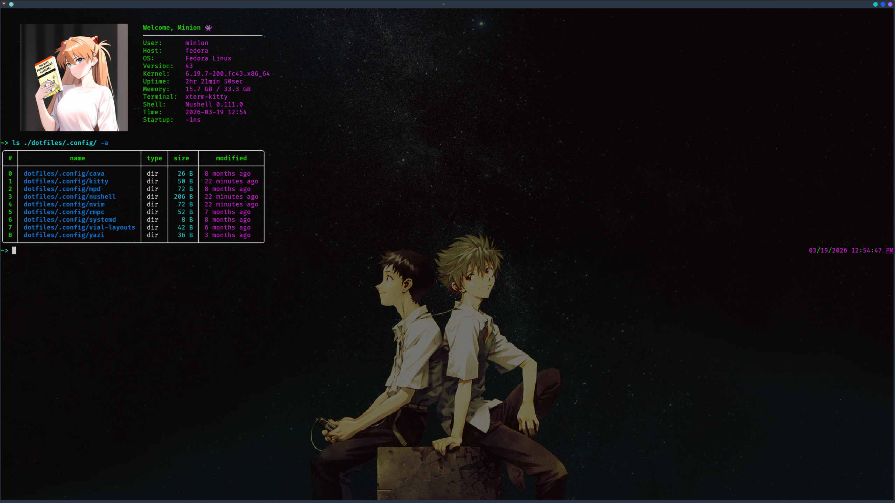
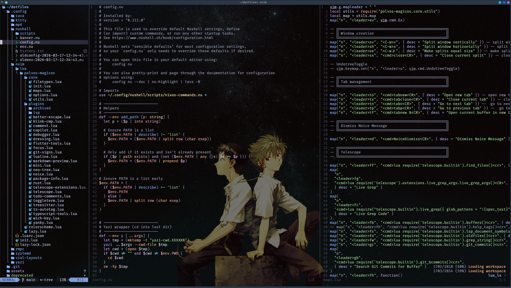

# macOS dotfiles

Personal terminal, editor and media configuration for macOS, installed with
Homebrew and linked with GNU Stow.

Branches: [nixos](https://github.com/PolvosMagicos/dotfiles/tree/nixos)
(Niri, Quickshell and Home Manager setup) · **macos**.




## What's included

| Area | Configuration |
| --- | --- |
| Terminal and shell | Kitty, JetBrainsMono Nerd Font, Nushell, zoxide and fnm |
| Editor | Neovim, Lazy, Catppuccin, Tree-sitter, Telescope and language servers |
| Files | Yazi with archive shortcuts and preview tools |
| Media | MPV and optional MPD, rmpc and Cava music setup |
| Keyboard | Vial Colemak and QWERTY exports |

Shared application configs live in [`.config/`](.config). This branch excludes
Quickshell, Niri, Fuzzel, systemd services, Linux container settings, Nix commands
and the QML/Nix desktop editor tooling.

## Configuration guides

Each config has its own setup, dependencies and usage notes:

| Config | Guide |
| --- | --- |
| [cava](.config/cava/README.md) | Standalone audio visualizer |
| [kitty](.config/kitty/README.md) | Terminal, font, shell and background |
| [mpd](.config/mpd/README.md) | Local music server and visualizer FIFO |
| [mpv](.config/mpv/README.md) | Video rendering and playback |
| [nushell](.config/nushell/README.md) | Shell startup, paths and helper commands |
| [nvim](.config/nvim/README.md) | Editor plugins, language tools and shortcuts |
| [rmpc](.config/rmpc/README.md) | Music client and embedded visualizer |
| [yazi](.config/yazi/README.md) | File manager, plugins and archive shortcuts |

## Install dependencies

Install Apple's Command Line Tools (`xcode-select --install`) and
[Homebrew](https://brew.sh), then run:

```bash
git clone --branch macos --recurse-submodules https://github.com/PolvosMagicos/dotfiles.git ~/dotfiles
cd ~/dotfiles
bash scripts/install-macos.sh
```

For an existing checkout, switch to `macos` and run
`git submodule update --init --recursive` before installing. The submodule supplies
Yazi's `compress.yazi` archive plugin.

The script installs the [Brewfile](Brewfile) with
[`brew bundle install --no-upgrade`](https://docs.brew.sh/Brew-Bundle-and-Brewfile).
It installs missing packages without requesting upgrades to existing packages.
Homebrew may still update dependencies required by a new package. It works with
Homebrew on Apple Silicon and Intel, and also accepts `brew` already on `PATH`.
It does not link configs or start services.

The Brewfile includes terminal apps, shell tools, Neovim's configured language
servers and formatters, Rust, Yazi's preview/archive tools, music/video players,
Java 17, Android command-line tools and Flutter. Apple's tools provide `make`,
the C compiler and `clangd`. Neovim requires 0.12 or newer; Lazy restores the
shared plugin lockfile, and Tree-sitter downloads its parsers on first launch.
Ruff uses its native language server for Python diagnostics, formatting and code
actions.

Android SDK platforms/build tools, Android license acceptance, Xcode/iOS setup
and the ESP32 toolchain remain project-specific setup. The `esp-env` command
expects your own `~/export-esp.sh`. The `jb`/`jl` aliases expect Jupyter in your
Python environment. Keyboard layout setup is described below.

## Link configs

Preview and apply the Stow package from your home directory:

```bash
cd ~
stow -nv --no-folding dotfiles
stow --no-folding dotfiles
```

Move aside any conflicting configs before applying.
[Stow's ignore file](.stow-local-ignore) excludes the Brewfile, scripts, tests,
assets, keyboard layout exports, shell backups, and generated MPD state.
Assets stay in the checkout; the Nushell banner finds its image there.
Use `--no-folding` so exclusions inside config directories are respected.

Nushell on macOS also needs the native Application Support link. Follow the
[Nushell setup guide](.config/nushell/README.md), which preserves an existing
configuration before linking it.

Kitty finds Homebrew's `nu` on either architecture. Nushell initializes Homebrew
before zoxide and fnm, uses registered macOS JDKs, and preserves an existing
`JAVA_HOME` or `ANDROID_HOME`. Android defaults to `~/Library/Android/sdk` when
present, otherwise Homebrew's `share/android-commandlinetools` SDK.
Homebrew's Node works immediately; use `fnm install --lts` and `fnm default lts-latest`
if you want fnm to manage a separate Node installation.

To remove the Stow-managed links later:

```bash
cd ~
stow -D --no-folding dotfiles
```

The native Nushell link is created separately; remove it separately if you no
longer use this configuration.

## Optional music setup

MPD plays local files from `~/Music` through macOS CoreAudio, and rmpc controls
it through `/tmp/mpd_socket`. MPD also supplies `/tmp/mpd.fifo` to rmpc's embedded
Cava visualizer. This stack is optional for the shell and editor.
Create its runtime directories and start it explicitly after linking:

```bash
mkdir -p ~/.config/mpd/{playlists,database,log,state}
mpd ~/.config/mpd/mpd.conf
rmpc
```

This does not install a background service. The standalone Cava config uses its
platform default input; system audio capture may need a separately configured
loopback device.

## Keyboard and local data

Install Vial separately from
[its releases](https://github.com/vial-kb/vial-gui/releases), then load
[`vial-layouts/colemak.vil`](vial-layouts/colemak.vil) to apply the Colemak profile
shared with `nixos`. A QWERTY export is also included.

[`assets/`](assets) contains wallpapers, profile pictures and screenshots;
[`firefox/`](firefox) keeps older browser customizations for reference. These
directories and keyboard exports stay in the checkout and are used manually.
Kitty's background and the Nushell banner expect the checkout at `~/dotfiles`.

Stow excludes generated MPD state and shell backups. The existing MPD database
is still tracked by Git; review local data before committing changes.

## Checks

Run these from `~/dotfiles` after installing dependencies:

```bash
bash -n scripts/install-macos.sh
python3 -m unittest discover -s tests -v
nvim --headless -u NONE -i NONE -l tests/nvim-check.lua
brew bundle check --file=Brewfile
```

The automated installer tests use a fake `brew`; they do not install packages.
A real macOS run is still needed to verify package installation, Kitty's GUI,
audio output and mobile tooling.
